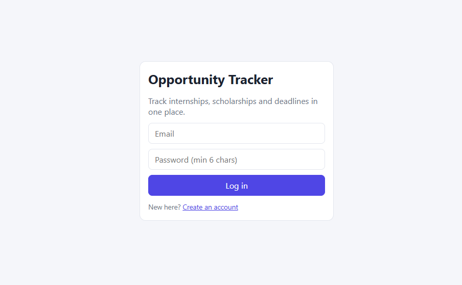
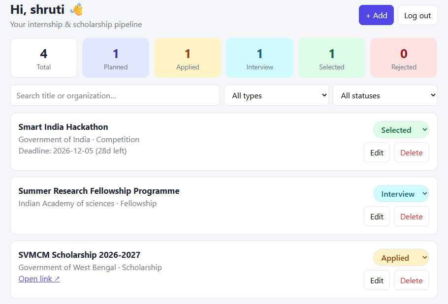
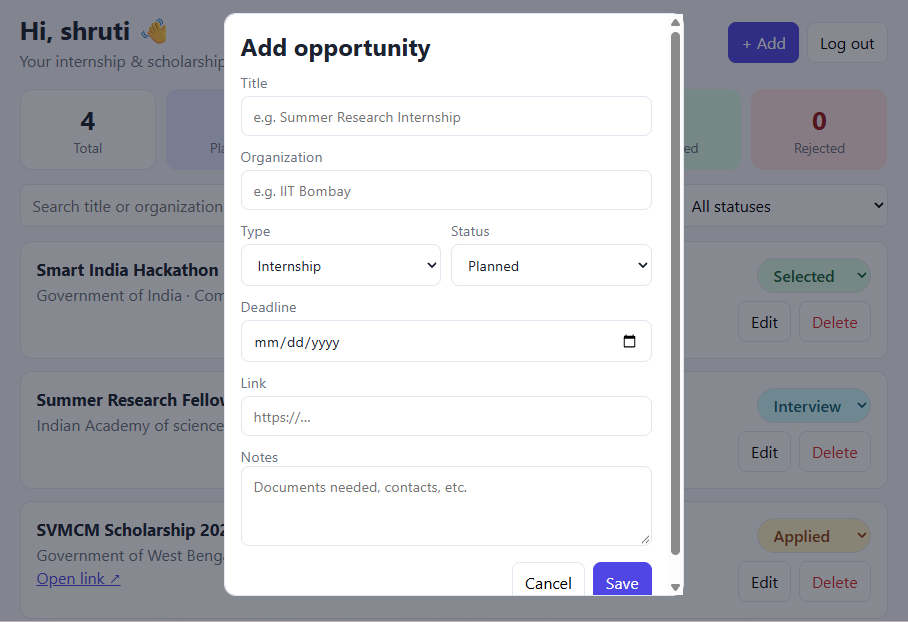

# Opportunity Tracker

A web app to keep track of internships, scholarships, fellowships and competitions in one place. You can add applications, update their status and see which deadlines are coming up.

## Screenshots











## Features

- Sign up and log in
- Add, edit and delete applications
- Change status: Planned, Applied, Interview, Selected, Rejected
- See upcoming deadlines on the dashboard
- Search and filter by type or status
- Daily email reminders for deadlines (optional)
- Every user sees only their own data

## Tech Used

- **Frontend:** React, Vite
- **Backend:** Node.js, Express
- **Database:** SQLite
- **Login:** JWT and bcrypt

## How to Run

You need Node.js installed.

**Backend**
```
cd server
npm install
copy .env.example .env
npm start
```
Open `.env` and set `JWT_SECRET` to any long random text before starting.

**Frontend** (in a new terminal)
```
cd client
npm install
npm run dev
```

Then open http://localhost:5173 in your browser.

## What I Learned

- How login works with tokens
- How a React app talks to an Express API
- How to save data in a database
- How to organize a full-stack project

## Future Ideas

- Calendar export
- Kanban board
- Document upload for each application